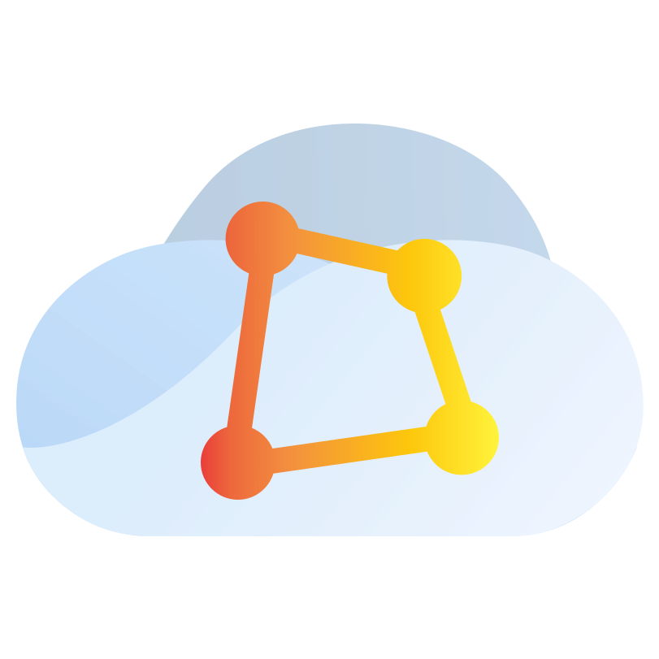

# Midfeed Cloud — Desktop

The official desktop app for **Midfeed Cloud** — one native workspace for opening and managing your Midfeed cloud apps on macOS.

---

## Download

Get the latest build from **[Releases](https://github.com/midfeed/cloud-desktop/releases/latest)**.

| Platform | File |
| --- | --- |
| macOS · Apple Silicon | `Midfeed Cloud-<version>-arm64.dmg` |

## Install

1. Open the downloaded `.dmg`.
2. Drag **Midfeed Cloud** into **Applications**.
3. Launch it and sign in with your Midfeed account.

## Updates

The app keeps itself up to date. When a new version is published here it downloads
in the background and offers to restart onto it — no manual reinstall.

## Requirements

- macOS 12 (Monterey) or later · Apple Silicon
- A Midfeed partner account

## Support

This repository hosts signed release binaries only. For help, contact us at **dev@midfeed.com**.

## Security

To report a security vulnerability, please email **dev@midfeed.com** — see our [Security Policy](SECURITY.md).

---

© 2026 Midfeed. All rights reserved.

